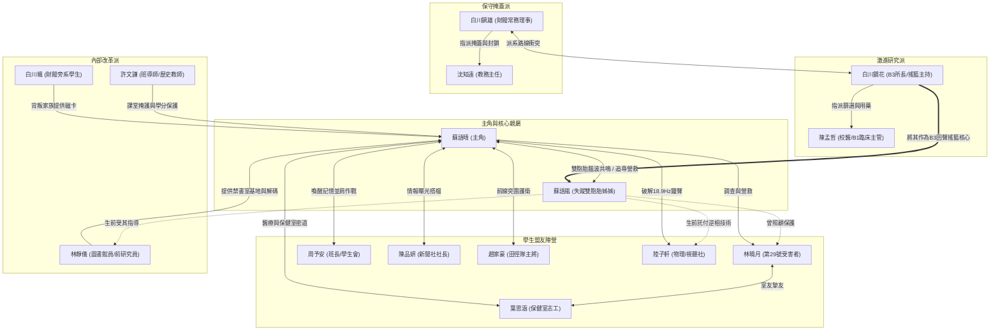

# 《無名校區》(Nameless Campus) — 角色關係與派系互動設計 (CHARACTER RELATIONSHIPS)

- **文件版本**：v1.0 (Production Phase 5)
- **關聯系統**：`CharacterRelationshipSystem`、`EndingEvaluator`、`QuestSystem`
- **核心全域變數**：`studentAffinity`（學生好感度）、`studentTrust`（學生信任度）、`corporateAlert`（財閥警戒度）

---

## 一、角色關係拓樸圖 (Relationship Topology)

---

## 二、三大派系對立與互動矩陣

校園內的政治與陰謀由三大派系相互牽制，主角蘇語晴可以利用**「保守掩蓋派」**與**「激進研究派」**之間的矛盾來創造調查空檔：

| 派系名稱 | 核心成員 | 對「第29號席位」的態度 | 對主角（蘇語晴）的處置手段 | 可被主角利用的弱點 |
| :--- | :--- | :--- | :--- | :--- |
| **保守掩蓋派** | 白川鎮雄、沈知遠 | 視為歷史污點，企圖銷毀 1954～1999 年舊檔案並將舊校舍與實驗室徹底封死。 | 以校規扣減 `academicCredits`（學分）、強制退學、洗去表層記憶遣返。 | 懼怕醜聞外洩（`publicExposure` 升高時會與激進派發生內鬨，調離部分地下守衛）。 |
| **激進研究派** | 白川鏡花、陳孟哲 | 視為「回聲搖籃計畫」的珍貴耗材，持續透過 `18.9Hz` 第四聲鐘響收集數據。 | 表面溫和誘導，暗中提高主角的 `experimentCorruption`，企圖將主角活捉進 B3 與蘇語嵐進行雙子同步。 | 實驗設備高度依賴頂樓廣播塔與 B2 次聲波陣列，一旦頻率被陸子軒逆轉即會全面癱瘓。 |
| **內部改革派** | 林靜儀、許文謙、白川颯 | 視為必須停止的罪惡，暗中備份受害學生名單並尋找摧毀回聲搖籃的方法。 | 在不暴露身分的前提下提供禁書室庇護、學分擔保、門禁卡與 1998 年原始磁帶。 | 人數稀少且受監控，必須依靠主角串聯學生群體（提高 `studentAffinity` 與 `studentTrust`）才能發動全面反擊。 |

---

## 三、好感度 (`studentAffinity`) 與信任度 (`studentTrust`) 雙軸設計

在《無名校區》正式版中，`CharacterRelationshipSystem` 採用**「情感好感度 (`studentAffinity`)」**與**「理性信任度 (`studentTrust`)」**雙軸獨立計算（範圍皆為 `0 ~ 100`）：

### 1. 雙軸定義與差異
- **`studentAffinity`（學生好感度）**：
  - 代表同學們對蘇語晴的情感認同、日常互助、社團支援與同伴情誼。
  - **提升途徑**：完成同學的個人委託（如幫葉思涵拿回無毒藥品、幫趙家豪找回接力棒、與陳品妍沖洗照片）、在日常對話中選擇關心與共情的選項。
  - **主要作用**：解鎖同伴隨行支援（醫療包紮、戰鬥格擋掩護、暗房洗相片），並作為結局 **C（群體反抗）** 的情感動員基礎。
- **`studentTrust`（學生信任度）**：
  - 代表在「認知過濾機制」的干擾下，學生群體有多相信蘇語晴所揭露的「第29號席位與地下實驗室」真相，而非把她當成精神錯亂的怪人。
  - **提升途徑**：在對話中出示具體的**物證**（如兩本不一致的點名簿、1998 年校務文件、林曉月的素描本、18.9Hz 示波器紀錄），並成功救出林曉月。
  - **主要作用**：決定學生是否願意冒著被退學或遭遇危險的風險，在第四章響應號召參與校門集結與 B1～B3 攻佔行動。

### 2. 各角色關係階段門檻表 (Relationship Tiers)

每位可互動學生／改革派角色皆設有三階段關係狀態：

| 角色 | 階段 1：疏離／受過濾屏蔽 (0~39) | 階段 2：動搖／秘密協力 (40~74) | 階段 3：完全覺醒／生死盟友 (75~100) |
| :--- | :--- | :--- | :--- |
| **周予安** | 嚴格執行校規，禁止主角碰觸第29張課桌。 | 發現點名簿矛盾，默許主角夜間在走廊調查。 | 撕毀偽造名冊，率領學生會幹部在校門集結響應攻佔。 |
| **陳品妍** | 將主角當成普通消息來源，交換校園傳聞。 | 開放新聞社暗房，協助整理 1954～1999 證據鏈。 | 聯絡校外記者與受害學生家長，大幅提升 `publicExposure`。 |
| **趙家豪** | 覺得主角神神叨叨，但願意在走廊幫忙擋惡霸。 | 想起失蹤玩伴，主動護送主角探索宿舍與頂樓。 | 擔任攻佔行動前鋒隊長，破開教師辦公室與 B1 封鎖鐵門。 |
| **白川颯** | 冷言警告主角離開學校，拒絕透露家族內情。 | 暗中遞交教師辦公室鑰匙與財閥巡邏班表。 | 公開與白川鎮雄決裂，親手解除 B2 生物識別門鎖。 |
| **葉思涵** | 害怕陳孟哲校醫，對林曉月的名字避而不談。 | 坦白保健室布簾後的聽聞，提供主角急救治療。 | 在攻佔保健室時反鎖陳孟哲的藥櫃，指引眾人進入 B1 升降梯。 |
| **陸子軒** | 沉浸於電波研究，嫌主角打擾他測音。 | 承認蘇語嵐曾找過他，開始組裝逆相音叉。 | 在頂樓廣播塔完成全校逆相廣播，徹底粉碎 `18.9Hz` 認知過濾。 |
| **許文謙** | 在課堂上維持一般師生互動，暗中給出歷史提示。 | 為主角擋下沈知遠的記過處分，維持 `academicCredits`。 | 串聯校內良知教師，在攻佔教師辦公室時從內部開門迎接學生。 |
| **林靜儀** | 僅允許主角借閱一般館藏，觀察主角是否可靠。 | 開啟舊圖書館「禁書室」，提供安全屋與解碼支援。 | 交付 1994 年「回聲搖籃」核心結構圖與逆轉金鑰，親自引導 B3 決戰。 |

---

## 四、角色間交叉影響與衝突事件 (Cross-Character Dynamics)

1. **【周予安 vs 趙家豪：秩序與衝動的摩擦】**
   - 在第二章調查初期，趙家豪主張直接砸開教務處搶名冊，周予安則主張先蒐集比對證據。
   - 若主角偏袒盲目暴力，會導致 `corporateAlert` 暴增 `+25` 且周予安信任度下降；若主角以林靜儀提供的線索調和兩人，則兩人同時獲得 `+10 studentTrust`。
2. **【葉思涵 vs 陳孟哲：保健室的心理攻防】**
   - 若主角在尚未確保葉思涵安全前，就直接拿著處方箋去質問陳孟哲，陳孟哲會將葉思涵調離保健室並銷毀部分 B1 通行紀錄。
   - 正確流程為先提升葉思涵信任度並與許文謙老師配合，將葉思涵保護於宿舍後再揭穿藥物成分。
3. **【白川颯 vs 陳品妍：對財閥姓氏的猜忌】**
   - 陳品妍起初因白川颯的姓氏而懷疑他是財閥派來的間諜。主角需在第三章透過「頂樓密會事件」促成兩人交換情報，才能同時達成高 `publicExposure` 與低 `corporateAlert` 的完美狀態。
