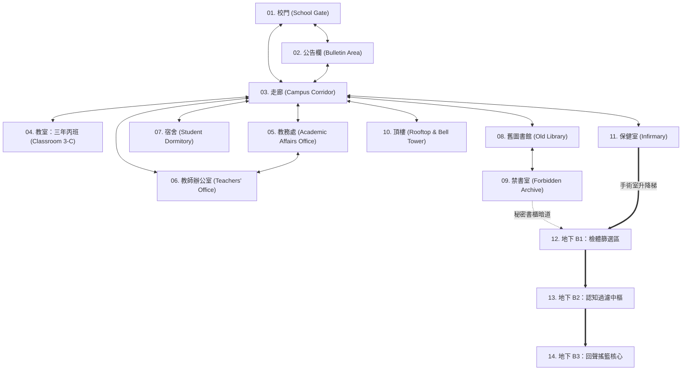

# 《無名校區》(Nameless Campus) — 完整世界地圖與14區域規劃 (WORLD MAP)

- **文件版本**：v1.0 (Production Phase 5)
- **地圖總數**：14 個可探索核心區域（地面校園 11 區 + 地下實驗室 3 區）
- **技術基準**：每個區域皆採用獨立場景設定（`AreaDefinition`）與安全落地出生點（`AreaSpawnPoint`），確保切換場景絕不卡牆或懸空。

---

## 一、14 大區域全校連接拓樸圖 (Campus Map Topology)

---

## 二、14 大區域逐區詳細規劃

---

### 01. 校門 (School Gate) — `school_gate`
- **場景尺寸與邊界**：寬 `960px` × 高 `360px`（地面 `floorY: 312`）。
- **環境氛圍**：濃霧籠罩的鐵欄正門、警衛亭與刻著「西元 2004 年正式啟用」的花崗岩校名碑。
- **駐留 / 出現 NPC**：蘇語晴（開場）、陳品妍（第一章偶遇）、周予安與失蹤學生家長群（第四章 C 結局集結點）。
- **關鍵互動物件與線索**：
  - `doc_admission_notice`：泛黃的入學通知書。
  - `obj_gate_stone_tablet`：2004 年建校石碑（仔細調查可發現水泥覆蓋了底下的 1977 年舊字樣）。
  - `obj_guard_booth_log`：警衛室夜間出入登記簿（記載深夜有冷藏車進出保健室後門）。
- **任務與事件**：
  - 第一章開場入學演出 (`evt_chapter1_opening_intro`)。
  - 第四章 **C 結局起點（第 1 站）**：主角、覺醒學生與家長於校門集結突破財閥封鎖線。
- **連接出入口**：
  - 東側步道 → `02. 公告欄` (`bulletin_area`)
  - 正門大門 → `03. 走廊` (`corridor`)

---

### 02. 公告欄 (Bulletin Area) — `bulletin_area`
- **場景尺寸與邊界**：寬 `880px` × 高 `360px`（地面 `floorY: 312`）。
- **環境氛圍**：連接校門與主校舍的半開放式連廊，木製玻璃櫥窗貼滿分班名冊、校規與被撕毀一半的尋人啟事。
- **駐留 / 出現 NPC**：陳品妍（新聞社社長）、一般圍觀學生。
- **關鍵互動物件與線索**：
  - `obj_campus_bulletin_board`：公告欄（張貼 28 人正式班級名冊，角落有紅粉筆留言）。
  - `doc_missing_student_poster`：失蹤學生海報（林曉月，學號 0419，第29號席位）。
  - `pickup_rusted_classroom_key`：藏在長椅下方的「生鏽的三年丙班鑰匙」。
- **任務與事件**：
  - 支線《暗房裡的1998》起點：協助陳品妍張貼真相特刊以提升 `publicExposure`。
  - 第四章 **C 結局攻佔第 2 站**：張貼全校覺醒檄文與財閥罪證，瓦解保守派宣傳。
- **連接出入口**：
  - 西側步道 → `01. 校門` (`school_gate`)
  - 東側側門 → `03. 走廊` (`corridor`)

---

### 03. 校園走廊 (Campus Corridor) — `corridor`
- **場景尺寸與邊界**：寬 `1600px`（Demo 為 `1280px`，正式版擴充東翼樓梯口）× 高 `360px`（地面 `floorY: 312`）。
- **環境氛圍**：陰暗潮濕的磨石子長廊，牆上掛著校史銅牌與廣播擴音器；夜間第四聲鐘響後燈光轉為昏暗紅光，有夜巡人員走動。
- **駐留 / 出現 NPC**：趙家豪（日間巡視／護衛）、白川颯（走廊窗邊）、沈知遠（夜間巡邏威脅）。
- **關鍵互動物件與線索**：
  - `obj_corridor_notice_cabinet`：走廊歷史沿革碑（記載白川財閥捐資與 2004 年啟用）。
  - `obj_corridor_speaker_unit`：走廊廣播擴音器（陸子軒支線中可拆取線圈檢測 `18.9Hz` 殘留）。
  - `obj_corridor_fire_hydrant`：消防栓箱（潛行時可製造聲響引開巡邏守衛）。
- **任務與事件**：
  - 日夜轉換廣播事件、夜間潛行躲避沈知遠與財閥保全。
  - 第四章 **C 結局攻佔第 3 站**：趙家豪率領體育社團控制一樓主走廊交通樞紐。
- **連接出入口**：
  - 通往 `01. 校門`、`02. 公告欄`、`04. 教室`、`05. 教務處`、`06. 教師辦公室`、`07. 宿舍`、`08. 舊圖書館`、`10. 頂樓（樓梯）`、`11. 保健室`。

---

### 04. 教室：三年丙班 (Classroom 3-C) — `classroom`
- **場景尺寸與邊界**：寬 `840px` × 高 `360px`（地面 `floorY: 312`）。
- **環境氛圍**：排列著 28 張正常課桌與角落第 29 張異常課桌的教室，黑板停留在 11 月 7 日的值日名單。
- **駐留 / 出現 NPC**：周予安（班長）、許文謙（上課時段）、蘇語嵐（殘留記憶幻影）。
- **關鍵互動物件與線索**：
  - `obj_classroom_desk`：第29號課桌（刻有「點名簿把我的名字抹掉了」與林曉月素描殘頁）。
  - `pickup_brass_locker_token`：刻有校徽與學號 0419 的黃銅名牌。
  - `doc_mysterious_school_file`：1998 年 11 月 7 日神祕校務文件（早於建校日的不合理檔案）。
  - `obj_classroom_blackboard`：黑板與紅粉筆槽。
- **任務與事件**：
  - 第一章核心調查與「新生已完成觀察」閃爍警訊；第二章《兩本點名簿》喚醒周予安事件。
  - 第四章 **C 結局攻佔第 4 站**：周予安在三年丙班敲響反抗課鐘，全班 28 名學生全數覺醒集結。
- **連接出入口**：
  - 教室前門 → `03. 走廊` (`corridor`)

---

### 05. 教務處 (Academic Affairs Office) — `academic_office`
- **場景尺寸與邊界**：寬 `920px` × 高 `360px`（地面 `floorY: 312`）。
- **環境氛圍**：擺滿鐵製檔案櫃、錦旗與大型雙重保險箱的行政重地，牆上掛著白川鎮雄的肖像。
- **駐留 / 出現 NPC**：沈知遠（教務主任）、行政職員／夜間財閥保全。
- **關鍵互動物件與線索**：
  - `obj_dean_safe_box`：沈知遠的雙重密碼保險箱（內藏《1954～1999 空白學籍註銷黑皮書》与封口費帳冊）。
  - `obj_confiscated_locker`：違禁品保管櫃（存放陳品妍被沒收的 1999 年舊校舍底片）。
  - `obj_academic_terminal`：學分與獎懲終端機（可查看或修正 `academicCredits`）。
- **任務與事件**：
  - 第二章夜間潛入竊取黑皮書主線；支線《主任保險箱的雙重帳冊》与《暗房裡的1998》。
- **連接出入口**：
  - 教務處正門 → `03. 走廊` (`corridor`)
  - 內部連通門 → `06. 教師辦公室` (`teachers_office`)

---

### 06. 教師辦公室 (Teachers' Office) — `teachers_office`
- **場景尺寸與邊界**：寬 `880px` × 高 `360px`（地面 `floorY: 312`）。
- **環境氛圍**：堆滿考卷、講義與茶具的教職員辦公區，許文謙老師的座位位於靠窗角落。
- **駐留 / 出現 NPC**：許文謙（歷史教師）、白川颯（偶爾被叫去問話）。
- **關鍵互動物件與線索**：
  - `obj_xu_desk_drawer`：許文謙老師的抽屜夾層（藏有《1977 年地下 B2 擴建工程藍圖》與晚自習通行證）。
  - `obj_attendance_archive_shelf`：歷年原始出缺席紀錄櫃（可找到未塗改前的三年丙班點名簿）。
  - `obj_fake_expulsion_form`：垃圾桶裡的偽造退學簽呈（第二章錯誤線索 2-A）。
- **任務與事件**：
  - 支線《兩本點名簿》與《被撕掉的歷史講義》。
  - 第四章 **C 結局攻佔第 5 站**：許文謙率領良知教師由內部開門，接管教師辦公室與行政廣播分機。
- **連接出入口**：
  - 辦公室大門 → `03. 走廊` (`corridor`)
  - 內部連通門 → `05. 教務處` (`academic_office`)

---

### 07. 宿舍 (Student Dormitory) — `dormitory`
- **場景尺寸與邊界**：寬 `900px` × 高 `360px`（地面 `floorY: 312`）。
- **環境氛圍**：雙層木床與鐵製儲物櫃並排的學生寢室區。林曉月與蘇語嵐曾住過的 304 室床位被貼上封條。
- **駐留 / 出現 NPC**：葉思涵（室友）、趙家豪（一樓交誼廳）。
- **關鍵互動物件與線索**：
  - `obj_dorm_bed_save`：蘇語晴的床鋪（提供安全休息、日夜切換與手動存檔）。
  - `obj_yulan_music_box`：蘇語嵐留在床板夾層的雙燕音樂盒（內含《蘇語嵐錄音日誌 #1》）。
  - `obj_zhao_locker`：走廊儲物櫃（藏有趙家豪失蹤玩伴的刻名接力棒）。
- **任務與事件**：
  - 支線《布簾後的處方箋》、《遺忘的接力棒》、《雙燕的回音》。
  - 第四章 **C 結局攻佔第 6 站**：喚醒全體住宿生，解除夜間門禁鎖，壯大反抗隊伍。
- **連接出入口**：
  - 宿舍大門 → `03. 走廊` (`corridor`)

---

### 08. 舊圖書館 (Old Library) — `old_library`
- **場景尺寸與邊界**：寬 `1040px` × 高 `360px`（地面 `floorY: 312`）。
- **環境氛圍**：高聳木製書架與彩繪玻璃窗構成的古典圖書館，深處有一座上了鎖的「地方文獻與校史特藏書櫃」。
- **駐留 / 出現 NPC**：林靜儀（圖書館管理員）、陳品妍（借用後方暗房）、陸子軒（查閱聲學文獻）。
- **關鍵互動物件與線索**：
  - `obj_library_counter`：林靜儀的借書台（可鑑定加密文件與錯誤線索）。
  - `obj_old_newspaper_microfilm`：微縮膠卷閱讀機（可查閱 1954～1999 年霧谷療養院與白川財閥剪報）。
  - `portal_library_to_forbidden`：特藏書櫃暗門（需林靜儀信任度或合成鑰匙開啟）。
- **任務與事件**：
  - 第二章開啟禁書室主線；陳品妍暗房沖洗照片支線。
  - 第四章 **C 結局攻佔第 7 站**：林靜儀與陳品妍於舊圖書館建立指揮與證據備份中心。
- **連接出入口**：
  - 圖書館正門 → `03. 走廊` (`corridor`)
  - 特藏書櫃暗門 → `09. 禁書室` (`forbidden_archive`)

---

### 09. 禁書室 (Forbidden Archive) — `forbidden_archive`
- **場景尺寸與邊界**：寬 `760px` × 高 `360px`（地面 `floorY: 312`）。
- **環境氛圍**：位於舊圖書館夾層後的密閉石造房間，牆上貼滿蘇語嵐與林靜儀調查繪製的「白川財閥關係網」與歷屆第29號失蹤學生名單。
- **駐留 / 出現 NPC**：林靜儀。
- **關鍵互動物件與線索**：
  - `doc_1968_infrasound_report`：《1968 年 18.9Hz 次聲波共鳴實驗原始報告》。
  - `doc_kyoka_patient_zero_file`：《1986 年第零號受試者：白川鏡花病歷》（解鎖 E 結局關鍵線索）。
  - `obj_yulan_recorder_tape`：蘇語嵐留下的加密錄音筆與逆轉金鑰碎片（一）。
  - `portal_forbidden_to_b1`：通往地下 B1 的早期通風豎井密道。
- **任務與事件**：
  - 第二章結尾轉折演出；支線《守書人的贖罪》與《第零號觀察者》。
- **連接出入口**：
  - 書櫃暗門 → `08. 舊圖書館` (`old_library`)
  - 豎井密道 → `12. 地下 B1` (`underground_b1`)

---

### 10. 頂樓 (Rooftop & Bell Tower) — `rooftop`
- **場景尺寸與邊界**：寬 `960px` × 高 `360px`（地面 `floorY: 312`）。
- **環境氛圍**：鐵絲網圍繞的校舍天台，矗立著巨大的舊式鐘塔與白川電工製的高功率次聲波廣播天線，夜風凜冽。
- **駐留 / 出現 NPC**：陸子軒（物理社社長）、白川颯（夜間密會）。
- **關鍵互動物件與線索**：
  - `obj_bell_tower_amplifier`：鐘塔次聲波調變器（顯示每晚第四聲鐘響固定輸出 `18.9Hz`）。
  - `obj_counter_phase_transmitter`：陸子軒的逆相波發射台（可安裝收集到的諧振零件）。
- **任務與事件**：
  - 支線《18.9Hz 的逆相波》与《染血的家徽》。
  - 第四章 **C 結局攻佔第 8 站**：陸子軒與主角佔領頂樓鐘塔，向全校發射逆相聲波，徹底解除全校師生的認知過濾！
- **連接出入口**：
  - 天台鐵門 → `03. 走廊` (`corridor`)

---

### 11. 保健室 (Infirmary) — `infirmary`
- **場景尺寸與邊界**：寬 `840px` × 高 `360px`（地面 `floorY: 312`）。
- **環境氛圍**：刺鼻消毒水味與白色隔簾交錯的醫務室，最內側的手術觀察床後方隱藏著通往地底的重型貨梯。
- **駐留 / 出現 NPC**：葉思涵（日間志工）、陳孟哲（校醫）。
- **關鍵互動物件與線索**：
  - `obj_infirmary_medicine_cabinet`：上鎖的藥品櫃（存放偽裝成維他命的「順從鎮靜劑」與解毒劑）。
  - `doc_b1_transfer_manifest`：《特殊檢體移交 B1 簽收單》（記載蘇語嵐與林曉月的轉移時間）。
  - `portal_infirmary_to_b1`：偽裝成醫療廢棄物升降梯的 **地下 B1 主入口**。
- **任務與事件**：
  - 支線《甜味鎮靜劑》；第三章突入地底主線起點。
  - 第四章 **C 結局攻佔第 9 站**：控制保健室醫療物資並開啟升降梯，打通攻入地下 B1～B3 的主通道。
- **連接出入口**：
  - 保健室正門 → `03. 走廊` (`corridor`)
  - 醫療升降梯 → `12. 地下 B1` (`underground_b1`)

---

### 12. 地下 B1：檢體篩選與記憶清洗區 (Underground B1) — `underground_b1`
- **場景尺寸與邊界**：寬 `1120px` × 高 `360px`（地面 `floorY: 312`）。
- **環境氛圍**：1954 年建造的斑駁水泥坑道與近代無菌隔間混合的陰森設施，設有整排記憶清洗電擊椅與單向玻璃觀察室。
- **駐留 / 出現 NPC**：陳孟哲（區域頭目）、財閥地下保安員。
- **關鍵互動物件與線索**：
  - `doc_1954_sanatorium_ledger`：《1954 年霧谷療養院初代人體聲學實驗日誌》。
  - `obj_memory_scrub_chair`：第 29 號記憶清洗椅（留有蘇語嵐反抗時扯斷的束縛帶與錄音日誌 #4）。
  - `pickup_b2_security_card`：擊敗或智取陳孟哲後取得的「B2 中樞通行磁卡」。
- **任務與事件**：
  - 第三章潛行與陳孟哲對決事件。
  - 第四章 **C 結局攻佔第 10 站**：突破地下第一道防線，釋放 B1 觀察室的受困學生並銷毀記憶清洗設備。
- **連接出入口**：
  - 醫療升降梯 → `11. 保健室` (`infirmary`)
  - 豎井密道 → `09. 禁書室` (`forbidden_archive`)
  - 防爆階梯門 → `13. 地下 B2` (`underground_b2`)

---

### 13. 地下 B2：認知過濾中樞與次聲波發射站 (Underground B2) — `underground_b2`
- **場景尺寸與邊界**：寬 `1200px` × 高 `360px`（地面 `floorY: 312`）。
- **環境氛圍**：1977 年擴建的重工業風地下掩體，巨大的低頻共鳴管線貫穿天花板，兩側為關押排斥反應實驗體的強化玻璃隔離牢房。
- **駐留 / 出現 NPC**：林曉月（受困於 29 號隔離室）、白川鎮雄（第四章現身）、失控實驗體守衛（Enemy AI）。
- **關鍵互動物件與線索**：
  - `obj_cell_29_door`：第 29 號隔離牢房（營救林曉月並取得《B3 回聲搖籃結構素描》）。
  - `obj_infrasound_core_array`：`18.9Hz` 主發射陣列控制台（可安裝逆相分流晶片，亦包含錯誤線索 3-A 斷電拉桿）。
  - `doc_1986_seat29_protocol`：《1986 年第29號席位群體遺忘觀測協定》。
- **任務與事件**：
  - 第三章營救林曉月與躲避失控實驗體；第四章與白川鎮雄的正面對質。
  - 第四章 **C 結局攻佔第 11 站**：白川颯協助解除安防，學生與家長代表癱瘓 B2 次聲波主機並瓦解白川鎮雄的私人衛隊。
- **連接出入口**：
  - 上層防爆門 → `12. 地下 B1` (`underground_b1`)
  - 深層升降平台 → `14. 地下 B3` (`underground_b3`)

---

### 14. 地下 B3：回聲搖籃核心研究區 (Underground B3) — `underground_b3`
- **場景尺寸與邊界**：寬 `1080px` × 高 `360px`（地面 `floorY: 312`）。
- **環境氛圍**：1994 年建造的巨型圓頂地下聖堂式實驗廳。中央為散發幽綠光芒的「回聲搖籃」神經共鳴巨槽，蘇語嵐漂浮於核心艙內，四周環繞著腦波主機與第 1～28 代實驗體的意識儲存柱。
- **駐留 / 出現 NPC**：蘇語嵐（核心培養槽）、白川鏡花（最終頭目）。
- **關鍵互動物件與線索**：
  - `obj_echo_cradle_mainframe`：回聲搖籃主控台（最終決戰互動核心：可選擇「注入逆相頻率徹底摧毀搖籃」、「強行拔除管線」或「接入自身意識成為新任觀察者」）。
  - `obj_yulan_stasis_pod`：蘇語嵐的維生共鳴艙。
  - `doc_1994_echo_cradle_charter`：《1994 年回聲搖籃計畫最高機密綱領》。
- **任務與事件**：
  - 第三章結尾窺探事件；第四章最終 Boss 戰與五大結局（A / B / C / D / E）最終分流點。
  - 第四章 **C 結局攻佔最終站（第 12 站）**：眾人攻入 B3 核心，合力擊潰白川鏡花的防衛機制，安全救出蘇語嵐並徹底粉碎回聲搖籃計畫。
- **連接出入口**：
  - 深層升降平台 → `13. 地下 B2` (`underground_b2`)
